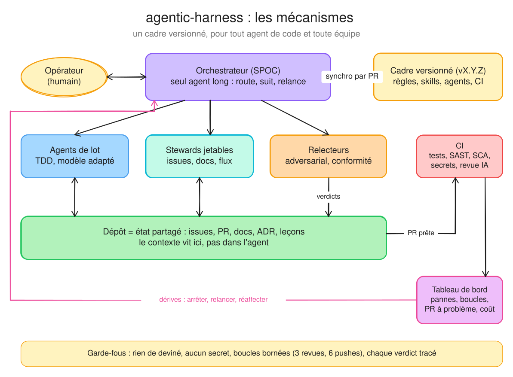
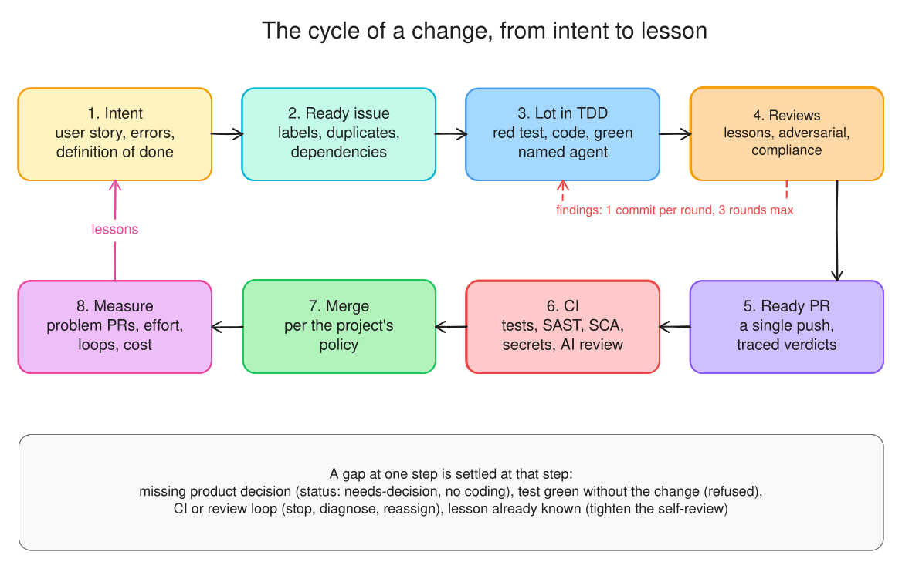
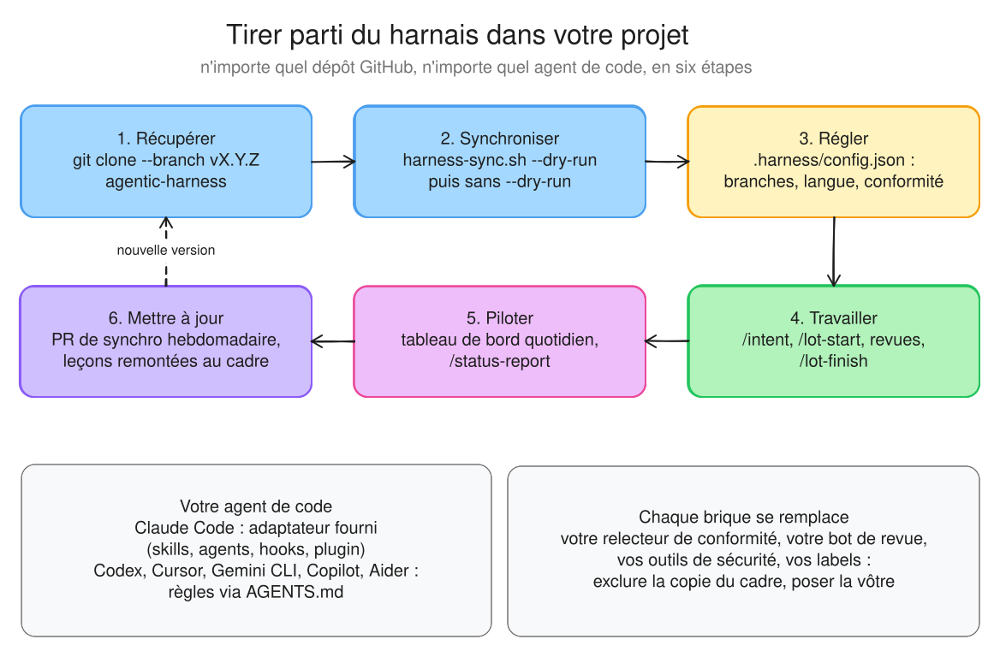

# agentic-harness

> Un harnais versionné et ouvert pour développer avec des agents de code : intention et TDD, issues → lots → PR,
> revues adversariales, conformité branchable, stewards, FinOps et tableau de bord du flux. Pour tout dépôt GitHub,
> tout agent (Claude Code, Codex, Cursor, Gemini CLI, Copilot, Aider…) et toute équipe.



**TL;DR** : les agents écrivent vite, mais sans cadre ils dérivent (contexte perdu, revues en boucle, CI qui brûle des
minutes, qualité inégale). Le harnais donne à chaque projet **la même méthode, les mêmes garde-fous, les mêmes leçons
et les mêmes contrôles**, récupérés à une version donnée et mis à jour par PR. Le contexte vit dans le dépôt, pas
dans l'agent. L'opérateur parle à un seul orchestrateur, qui délègue chaque tâche au bon niveau de modèle et la fait
relire par un modèle plus fort. Chaque brique se garde, se remplace ou se complète.

## Ce que ça change, concrètement

| Sans harnais | Avec |
|---|---|
| L'agent devine l'intention | Chaque issue porte user story, comportements d'erreur, définition de fini (`/intent`) |
| Des tests écrits après coup, parfois verts sans le changement | TDD : test vu rouge, puis vert ; prouvé dans la PR |
| L'auteur se relit lui-même | Revue adversariale par un autre modèle, verdicts tracés sur la PR |
| Un push par idée, une CI coûteuse par push | Pushes fréquents sur un brouillon sans CI coûteuse, CI complète au passage « Ready », un commit par cycle de revue, boucles bornées (3 cycles, 6 pushes testés) |
| Conformité oubliée ou manuelle | Relecteurs RGPD, AI Act, NIS2, ISO 27001, SOC 2, TISAX, PCI, HDS, ou les vôtres, lancés seulement si le diff les concerne |
| « Où en est-on ? » | Tableau de bord quotidien : jalons, goulots, pannes, boucles, **ratio de PR à problème**, coût |
| Les mêmes erreurs d'un projet à l'autre | 82 leçons sourcées, enrichies par issue « Leçon » |

## Le cycle d'un changement



## Tirer parti du harnais dans votre projet



```bash
git clone --depth 1 --branch v0.3.0 https://github.com/francoisgn/agentic-harness.git ../agentic-harness
../agentic-harness/scripts/harness-sync.sh --target . --dry-run   # voir avant d'écrire
../agentic-harness/scripts/harness-sync.sh --target .
```

Ensuite : régler `.harness/config.json` (branches, langue, exclusions, `compliance`) et `.github/workflows/harness.yml`
([ADOPTION](docs/ADOPTION.md)), puis travailler au quotidien ([UTILISATION](docs/UTILISATION.md), exemple complet sur
un client iOS).

| Votre agent | Ce qu'il reçoit |
|---|---|
| **Claude Code** (adaptateur fourni) | Bloc `CLAUDE.md`, skills (`/intent`, `/lot-start`, `/review-round`…), agents (`adversarial-reviewer`, stewards, conformité), hooks garde-fous ; ou le plugin : `claude plugin marketplace add francoisgn/agentic-harness && claude plugin install harness@agentic-harness` |
| **Autres agents** (Codex, Cursor, Copilot, Gemini CLI, Aider…) | Bloc `AGENTS.md` ([format ouvert](https://agents.md)) qui pointe vers les règles (`.harness/docs/ESSENTIEL.md`) ; lu nativement ou à activer selon l'outil ([ADOPTION](docs/ADOPTION.md) §Brancher votre agent) ; méthode, labels, gabarits, CI et tableau de bord identiques |
| **Équipe humaine** | Les mêmes issues, labels, PR, CI et tableau de bord ; rapport d'état lisible par un non-technicien |

## État

| Capacité | État | Où |
|---|---|---|
| Méthode, conventions, leçons, branches, budget CI | 🟢 en service | `docs/` |
| Vendorisation, plugin, workflows de labels et d'hygiène | 🟢 en service, testés en CI | `scripts/harness-sync.sh`, `.github/workflows/` |
| Intention, TDD, FinOps, stewards, nommage des agents | 🟢 0.2.0 | METHODOLOGY, FINOPS, STEWARDS, ORCHESTRATION §7 |
| Tableau de bord du flux, ratio de PR à problème | 🟢 testé hors ligne ; 🟠 premier passage réel à observer | `flow-metrics.py`, `flow-report.yml` |
| Conformité branchable (agent du cadre, de l'entreprise, ou spec seule) | 🟢 résolution testée | COMPLIANCE §2 |
| Agents de conformité intégrés | 🟠 fondation : identifiants « (à vérifier) » à confirmer sur les textes officiels | `plugins/harness/agents/compliance-*.md` |
| Pipeline sécurité, revue IA, réglages du dépôt « as code » | 🟠 à valider sur un premier projet | `security.yml`, `ai-review.yml`, `repo-settings.yml` |

## Contenu

| Chemin | Rôle |
|---|---|
| [`docs/ESSENTIEL.md`](docs/ESSENTIEL.md) | Les règles chargées à chaque session |
| [`docs/UTILISATION.md`](docs/UTILISATION.md) | **Guide pas à pas** pour un projet, avec un exemple complet |
| [`docs/ADOPTION.md`](docs/ADOPTION.md) | Adopter, régler, remplacer une brique, mettre à jour, retirer ; réglages du dépôt « as code » |
| [`docs/METHODOLOGY.md`](docs/METHODOLOGY.md) | Boucle pilotée par les issues, intention, TDD, lots, labels |
| [`docs/ORCHESTRATION.md`](docs/ORCHESTRATION.md) | Orchestrateur, sous-agents, niveaux de modèle, revue adversariale, nommage des agents |
| [`docs/FINOPS.md`](docs/FINOPS.md) | Routage des modèles, quotas et reprise, boucles bornées, signaux de dérive |
| [`docs/STEWARDS.md`](docs/STEWARDS.md) | Rôles d'entretien (issues, docs, flux) et rapport d'état non technique |
| [`docs/REVIEW-ROUNDS.md`](docs/REVIEW-ROUNDS.md), [`docs/REVIEW-SERVICE.md`](docs/REVIEW-SERVICE.md) | Cycles de revue, traçabilité des verdicts, service de revue IA |
| [`docs/COMPLIANCE.md`](docs/COMPLIANCE.md) | Relecteurs de conformité : catalogue, trois modes de branchement |
| [`docs/CI-BUDGET.md`](docs/CI-BUDGET.md) | Minutes de CI, sécurité (SAST, SCA, secrets), variables, volume agentique |
| [`docs/LESSONS.md`](docs/LESSONS.md) | Leçons par portée, sources citées ; comment en proposer |
| [`docs/CONVENTIONS.md`](docs/CONVENTIONS.md), [`docs/BRANCHING-RELEASE.md`](docs/BRANCHING-RELEASE.md), [`docs/MAC-HANDOFF.md`](docs/MAC-HANDOFF.md) | Commits et PR, branches et versions, partage cloud / poste local |
| [`docs/adr/`](docs/adr/README.md) | Décisions du cadre |
| [`docs/diagrams/`](docs/diagrams) | Schémas : source `.json`, scène `.excalidraw` (modifiable sur excalidraw.com), image `.svg` |
| `plugins/harness/` | Adaptateur Claude Code : 10 skills, 13 agents, hooks, plugin |
| `templates/`, `i18n/en/` | Gabarits vendorisés ; édition anglaise des fichiers chargés à chaque session |
| `.github/workflows/` | Workflows réutilisables (labels, hygiène, sécurité, revue IA, tableau de bord, réglages) et CI du cadre |
| `scripts/` | Synchro, tableau de bord, conformité, réglages, rendu des schémas, contrôles de cohérence, tests |

## Qualité du harnais lui-même

Un job de CI (`ci.yml`), chaque étape lancée même si la précédente échoue : cohérence du cadre (skills, agents,
manifeste, labels, nommage, contrôles requis), tests (vendorisation, hooks, tableau de bord, conformité, réglages,
schémas), ShellCheck, versions, actionlint, zizmor, markdownlint, gitleaks. En local :
```bash
python3 scripts/check-framework.py && python3 -m unittest discover -s scripts/tests -p 'test_*.py' \
  && scripts/tests/test-harness-sync.sh && python3 scripts/diagrams/render.py --check
```

## Versions et contributions
- Licence : [MIT](LICENSE). `harness-sync.sh` la copie dans `.harness/LICENSE` du projet, avec les fichiers du cadre.
- Sécurité : une faille se signale en privé, jamais dans une issue ([SECURITY](SECURITY.md)).
- Semver, tags `vX.Y.Z` sur `master`, [CHANGELOG](CHANGELOG.md) à chaque version (section « Action » pour les
  projets). Avant 1.0.0, un MINEUR peut casser : le CHANGELOG le dit.
- Contribuer : une issue avec son intention, une branche, une PR en brouillon, la CI verte, une revue par un autre
  modèle. Une leçon née dans votre projet : formulaire « Leçon ». Un schéma : modifier `docs/diagrams/<nom>.json`,
  lancer `scripts/diagrams/render.py`, commiter les trois fichiers.
- Origines : distillé de projets réels (dont un client iOS de forum, exemple public d'[UTILISATION](docs/UTILISATION.md)) ;
  inspirations citées : [OpenHarness](https://github.com/HKUDS/OpenHarness) (MIT) pour la boucle de réparation bornée
  et le tableau de bord ([ADR 0002](docs/adr/0002-agents-specialises-et-tableau-de-bord.md)).
