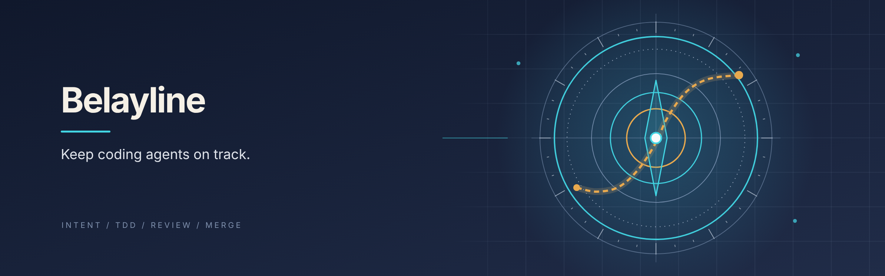
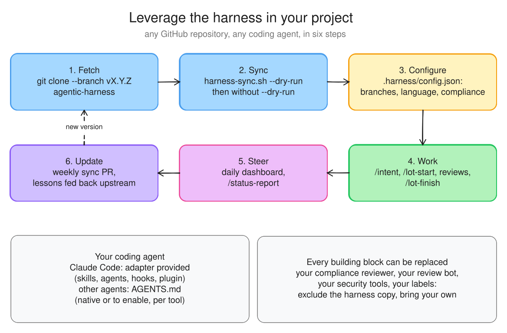

# Belayline

[](https://github.com/francoisgn/belayline-agentic-harness/actions/workflows/ci.yml)




> **Belayline: the open harness for agentic development.** Versioned skills, tools and method: intent and TDD, issues → lots → PRs, adversarial
> reviews, pluggable compliance, stewards, FinOps and a flow dashboard. For any GitHub repository, any agent (Claude
> Code, Codex, Cursor, Gemini CLI, Copilot, Aider…) and any team.

**TL;DR**: agents write fast, but without a harness they drift (lost context, review loops, CI that burns minutes,
uneven quality). The harness gives every project **the same method, the same guardrails, the same lessons and the
same checks**, fetched at a given version and updated by PR. The context lives in the repository, not in the agent.
The operator talks to a single orchestrator, which delegates each task to the right model tier and has it reviewed by
a stronger model. Each building block can be kept, replaced or extended.


## What it changes, concretely

| Without a harness | With it |
|---|---|
| The agent guesses the intent | Each issue carries a user story, error behaviours and a definition of done (`/intent`) |
| Tests written afterwards, sometimes green without the change | TDD: test seen red, then green; proven in the PR |
| The author reviews their own work | Adversarial review by another model, verdicts recorded on the PR |
| One push per idea, one expensive CI run per push | Frequent pushes on a draft without the expensive CI, full CI on the switch to "Ready", one commit per review cycle, bounded loops (3 cycles, 6 tested pushes) |
| Compliance forgotten or manual | Reviewers for GDPR, AI Act, NIS2, ISO 27001, SOC 2, TISAX, PCI, HDS, or your own, run only when the diff concerns them |
| A stale README, with no diagram and no progress | README maintained at the end of each lot: badges, Excalidraw diagram, lot table, checked in CI (`/readme-update`) |
| "Where are we?" | Daily dashboard: milestones, bottlenecks, stalled work, loops, **ratio of PRs with a problem**, cost |
| The same mistakes from one project to the next | 82 sourced lessons, extended through "Lesson" issues |

## The cycle of a change


## Quick start: using the harness in your project



```bash
git clone --depth 1 --branch v0.3.0 https://github.com/francoisgn/belayline-agentic-harness.git ../belayline
../belayline/scripts/harness-sync.sh --target . --dry-run   # look before writing
../belayline/scripts/harness-sync.sh --target .
```

Then: configure `.harness/config.json` (branches, language, exclusions, `compliance`) and
`.github/workflows/harness.yml` ([ADOPTION](docs/ADOPTION.md)), then work day to day ([USAGE](docs/USAGE.md), full
example on an iOS client).

| Your agent | What it receives |
|---|---|
| **Claude Code** (adapter provided) | `CLAUDE.md` block, skills (`/intent`, `/lot-start`, `/review-round`…), agents (`adversarial-reviewer`, stewards, compliance), guardrail hooks; or the plugin: `claude plugin marketplace add francoisgn/belayline-agentic-harness && claude plugin install belay@belayline` |
| **Other agents** (Codex, Cursor, Copilot, Gemini CLI, Aider…) | `AGENTS.md` block ([open format](https://agents.md)) that points to the rules (`.harness/docs/ESSENTIALS.md`); read natively or to be enabled, depending on the tool ([ADOPTION](docs/ADOPTION.md) §Connect your coding agent); same method, labels, templates, CI and dashboard |
| **Human team** | The same issues, labels, PRs, CI and dashboard; status report readable by a non-technical person |

## How to leverage the knowledge in this repo

The repository can be read and picked from without installing anything: each file stands alone, cites its sources,
and can be taken without the rest.

| You want to | Read | Or ask your agent |
|---|---|---|
| Understand the method in 5 minutes | [ESSENTIALS](docs/ESSENTIALS.md), then the three diagrams above | "Read `docs/ESSENTIALS.md` and tell me what my project is missing" |
| Avoid mistakes already made | [LESSONS](docs/LESSONS.md): 82 lessons sorted by scope, each one sourced | "Review my diff against `docs/LESSONS.md`" (skill `/lessons-check`) |
| Set up a lean, safe CI | [CI-BASELINE](docs/CI-BASELINE.md) (tiers, invariants), [CI-BUDGET](docs/CI-BUDGET.md) (costs, tools) | "Compare my workflows with the six invariants of `docs/CI-BASELINE.md`"; skill `/local-check` (one local command = the CI) |
| A README that stays true | [README-STANDARD](docs/README-STANDARD.md) | `/readme-update`, or `python3 scripts/readme-check.py --root <project>` |
| Have an agent's work reviewed | [REVIEW-ROUNDS](docs/REVIEW-ROUNDS.md), [ORCHESTRATION](docs/ORCHESTRATION.md) §3 | Agent `adversarial-reviewer`, skill `/review-round` |
| Frame an issue before coding | [METHODOLOGY](docs/METHODOLOGY.md) §2 bis | Skill `/intent` |
| Control cost (models, loops, minutes) | [FINOPS](docs/FINOPS.md) | Agent `flow-monitor`, skill `/status-report` |
| Understand what "we use Claude Code" or "we approved Copilot" actually covers: screens, agent, where it acts, who bills the model, which contract governs the data | [AI layers](docs/ai-layers/README.md): a guide in parts, starting with [apps and CLIs](docs/ai-layers/obo-agents.md) | "Using `docs/ai-layers/obo-agents.md`, turn our tool approval into one answer per layer" |
| Know why the harness is built this way | [ADR](docs/adr/README.md): context, rejected options, consequences | "Summarise the ADRs and what they rule out" |

Three ways to use it, from the lightest to the most complete:

1. **Read**: point an agent at this repository (clone or URL) and ask it the question; nothing is written on your
   side.
2. **Pick**: copy a skill (`plugins/harness/skills/<name>/`), an agent, a workflow or a script. The scripts use only
   the Python standard library; the skills cite the docs they assume.
3. **Adopt**: the versioned sync of the previous section, one building block at a time
   ([ADOPTION](docs/ADOPTION.md) §Partial adoption, §Replace or extend a building block).

Knowledge flows both ways: propose a lesson born in your project through the "Lesson" issue form (skill
`/lesson-propose`), with its source.

## Status

<!-- harness:begin progress -->
| Capability | Status | Where |
|---|---|---|
| Method, conventions, lessons, branches, CI budget | 🟢 in service | `docs/` |
| Vendoring, plugin, label and hygiene workflows | 🟢 in service, tested in CI | `scripts/harness-sync.sh`, `.github/workflows/` |
| Intent, TDD, FinOps, stewards, agent naming | 🟢 0.2.0 | METHODOLOGY, FINOPS, STEWARDS, ORCHESTRATION §7 |
| Flow dashboard, ratio of PRs with a problem | 🟢 tested offline; 🟠 first real run to observe | `flow-metrics.py`, `flow-report.yml` |
| Pluggable compliance (agent from the harness, from the company, or spec only) | 🟢 resolution tested | COMPLIANCE §2 |
| Built-in compliance agents | 🟠 foundation: "(to verify)" identifiers to confirm against the official texts | `plugins/harness/agents/compliance-*.md` |
| Security pipeline, AI review, repository settings "as code" | 🟠 to validate on a first project | `security.yml`, `ai-review.yml`, `repo-settings.yml` |
| Living README: badges, Excalidraw diagram, lot progress, Contributing | 🟢 checked in CI; 🟠 to validate on a first project | [README-STANDARD](docs/README-STANDARD.md), `readme-check.py`, `/readme-update` |
| Tiered CI baseline | 🟢 documented | [CI-BASELINE](docs/CI-BASELINE.md) |
<!-- harness:end progress -->

## Contents

| Path | Role |
|---|---|
| [`docs/ESSENTIALS.md`](docs/ESSENTIALS.md) | The rules loaded in every session |
| [`docs/USAGE.md`](docs/USAGE.md) | **Step-by-step guide** for a project, with a full example |
| [`docs/ADOPTION.md`](docs/ADOPTION.md) | Adopt, configure, replace a building block, update, remove; repository settings "as code" |
| [`docs/METHODOLOGY.md`](docs/METHODOLOGY.md) | Issue-driven loop, intent, TDD, lots, labels |
| [`docs/ORCHESTRATION.md`](docs/ORCHESTRATION.md) | Orchestrator, sub-agents, model tiers, adversarial review, agent naming |
| [`docs/FINOPS.md`](docs/FINOPS.md) | Model routing, quotas and resuming, bounded loops, drift signals |
| [`docs/STEWARDS.md`](docs/STEWARDS.md) | Upkeep roles (issues, docs, flow) and non-technical status report |
| [`docs/REVIEW-ROUNDS.md`](docs/REVIEW-ROUNDS.md), [`docs/REVIEW-SERVICE.md`](docs/REVIEW-SERVICE.md) | Review cycles, traceability of verdicts, AI review service |
| [`docs/COMPLIANCE.md`](docs/COMPLIANCE.md) | Compliance reviewers: catalogue, three ways to plug them in |
| [`docs/README-STANDARD.md`](docs/README-STANDARD.md) | The README that agents maintain by default: badges, image, Excalidraw diagram, progress, Contributing |
| [`docs/CI-BASELINE.md`](docs/CI-BASELINE.md), [`docs/CI-BUDGET.md`](docs/CI-BUDGET.md) | Tiered CI baseline; CI minutes, security (SAST, SCA, secrets), variables, agentic volume |
| [`docs/LESSONS.md`](docs/LESSONS.md) | Lessons by scope, sources cited; how to propose one |
| [`docs/CONVENTIONS.md`](docs/CONVENTIONS.md), [`docs/BRANCHING-RELEASE.md`](docs/BRANCHING-RELEASE.md), [`docs/MAC-HANDOFF.md`](docs/MAC-HANDOFF.md) | Commits and PRs, repository identity (description, topics, banner, social preview), branches and versions, split between cloud and local machine |
| [`docs/ai-layers/`](docs/ai-layers/README.md) | The layers of AI tools, by audience: presentation, agent, execution, inference and the contract behind it |
| [`docs/adr/`](docs/adr/README.md) | Decisions of the harness |
| [`docs/assets/`](docs/assets) | Visual identity: README banner (`banner.svg` → `.png`), social preview (`social-preview.svg` → `.png`, 1280×640) |
| [`docs/diagrams/`](docs/diagrams) | Diagrams: `.json` source, `.excalidraw` scene (editable on excalidraw.com), `.svg` image |
| `plugins/harness/` | Claude Code adapter: 12 skills, 13 agents, hooks, plugin |
| `templates/` | Vendored templates |
| `.github/workflows/` | Reusable workflows (labels, hygiene, security, AI review, dashboard, settings) and the harness CI |
| `scripts/` | Sync, dashboard, compliance, settings, diagram rendering, README check, consistency checks, tests |

## Quality of the harness itself

One CI job (`ci.yml`), each step run even if the previous one fails: harness consistency (skills, agents, manifest,
labels, naming, required checks, description, topics, banner and social preview), tests (vendoring, hooks, dashboard,
compliance, settings, diagrams), ShellCheck, versions, actionlint, zizmor, markdownlint, gitleaks. Locally, the same
steps (a test keeps them in line with `ci.yml`; a missing tool gives INCOMPLETE, never green):
```bash
scripts/local-check.sh            # everything CI runs; --quick: only the steps whose files changed
```

## Versions
- Security: report a flaw privately, never in an issue ([SECURITY](SECURITY.md)).
- Semver, tags `vX.Y.Z` on `master`, [CHANGELOG](CHANGELOG.md) at each version ("Action" section for projects).
  Before 1.0.0, a MINOR may break: the CHANGELOG says so.
- Origins: distilled from real projects (including an iOS forum client, the public example of [USAGE](docs/USAGE.md));
  inspirations cited:
  [OpenHarness](https://github.com/HKUDS/OpenHarness) (MIT) for the bounded repair loop and the dashboard
  ([ADR 0002](docs/adr/0002-specialised-agents-and-dashboard.md)).

## Contributing

See [CONTRIBUTING.md](CONTRIBUTING.md): an issue with its intent, a branch, a draft PR, green CI, a review by another
model. A lesson born in your project: "Lesson" form.

## License

[MIT](LICENSE). `harness-sync.sh` copies it into the project's `.harness/LICENSE`, with the harness files.
