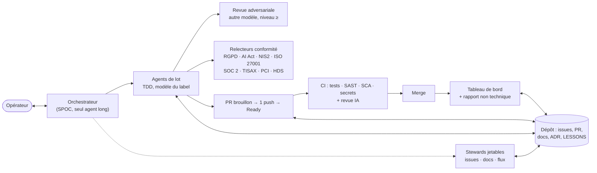

# agentic-harness

> Cadre versionné pour piloter le développement agentique (Claude Code) : intention et TDD, issues → lots → PR,
> revues adversariales, relecteurs de conformité, stewards, FinOps et tableau de bord du flux. Il s'adopte dans
> chaque projet à une version donnée.

**TL;DR** : un dépôt qui fournit à chaque projet de François **la même méthode, les mêmes garde-fous, les mêmes
leçons et les mêmes contrôles GitHub**. Le projet récupère le cadre à un tag (`harness-sync.sh`) et le met à jour par
PR. Le contexte vit dans le dépôt, pas dans l'agent. L'opérateur parle à un seul orchestrateur, qui délègue chaque
tâche au modèle adapté et la fait relire par un modèle plus fort.

Né de deux projets réels : **HFRnow / SwiftHFR** (client iOS, branche `dev-swift` : orchestration multi-sessions,
revues adversariales, 57 leçons) et **ios-app_credit-immo** (simulateur de crédit : workflow piloté par les issues,
labels modèle/taille, budget CI, reprise sur Mac). Ce qui est propre à leur domaine est resté chez eux ; le reste est
ici, généralisé. Inspirations externes citées : [OpenHarness](https://github.com/HKUDS/OpenHarness) (HKUDS, MIT) pour la boucle de réparation bornée et le
tableau de bord (ADR 0002).

## Comment ça marche



| Étape | Règle | Outil |
|---|---|---|
| Intention | User story, comportements d'erreur, critères testables, définition de fini | `/intent`, formulaires d'issue |
| Prise | Issue prête, prise en charge visible, agent nommé `<projet>.<orc>.<rôle>.<cible>` | `/lot-start`, `issue-steward` |
| Réalisation | TDD : test rouge, code, vert ; commits atomiques ; un push par lot | METHODOLOGY §2 ter |
| Vérification | Leçons, revue adversariale par un autre modèle, conformité si activée | `/lessons-check`, `adversarial-reviewer`, `/compliance-review` |
| CI | Brouillon = rien ; SAST, SCA, secrets, lint ; boucles bornées (3 revues, 6 passages) | `security.yml`, `ai-review.yml`, CI-BUDGET |
| Suivi | Panne, boucle, goulot, coût ; état lisible par un non-technicien | `flow-report.yml`, `/status-report` |
| Capitalisation | Une erreur nouvelle devient une leçon, remontée au cadre par issue | `/lesson-propose`, formulaire « Leçon » |

## État

| Capacité | État | Où |
|---|---|---|
| Méthode, conventions, leçons (82), branches, budget CI | 🟢 en service | `docs/` |
| Vendorisation, plugin, workflows de labels et d'hygiène | 🟢 en service, testé en CI | `scripts/harness-sync.sh`, `.github/workflows/` |
| Intention, TDD, FinOps, stewards, nommage des agents | 🟢 nouveau en 0.2.0 | METHODOLOGY, FINOPS, STEWARDS, ORCHESTRATION §7 |
| Tableau de bord du flux | 🟢 nouveau, testé hors ligne ; 🟠 premier passage réel à observer | `flow-metrics.py`, `flow-report.yml` |
| Pipeline sécurité, revue IA | 🟠 nouveau, à valider sur un premier projet | `security.yml`, `ai-review.yml` |
| Relecteurs de conformité | 🟠 fondation : identifiants « (à vérifier) » à confirmer sur les textes officiels | `plugins/harness/agents/compliance-*.md` |

## Contenu

| Chemin | Rôle |
|---|---|
| [`docs/ESSENTIEL.md`](docs/ESSENTIEL.md) | Règles chargées à chaque session (importées par le `CLAUDE.md` du projet) |
| [`docs/UTILISATION.md`](docs/UTILISATION.md) | **Guide pas à pas** pour un projet, avec l'exemple SwiftHFR |
| [`docs/METHODOLOGY.md`](docs/METHODOLOGY.md) | Boucle pilotée par les issues, intention, TDD, lots, parapluies, labels |
| [`docs/CONVENTIONS.md`](docs/CONVENTIONS.md) | Commits, PR, commentaires GitHub, persistance compatible |
| [`docs/LESSONS.md`](docs/LESSONS.md) | 82 leçons par portée, sources citées ; comment en proposer |
| [`docs/ORCHESTRATION.md`](docs/ORCHESTRATION.md) | Sessions parallèles, sous-agents, choix du modèle, revue adversariale, **nommage des agents** |
| [`docs/FINOPS.md`](docs/FINOPS.md) | Orchestrateur SPOC, routage des modèles, quotas et reprise, boucles bornées, dérives |
| [`docs/STEWARDS.md`](docs/STEWARDS.md) | Rôles d'entretien (issues, docs, flux) et rapport d'état non technique |
| [`docs/REVIEW-ROUNDS.md`](docs/REVIEW-ROUNDS.md) | Traiter un cycle de revue une fois, complètement |
| [`docs/REVIEW-SERVICE.md`](docs/REVIEW-SERVICE.md) | Service de revue IA maison (équivalent CodeRabbit) |
| [`docs/COMPLIANCE.md`](docs/COMPLIANCE.md) | Relecteurs de conformité : catalogue, activation, place dans la boucle |
| [`docs/CI-BUDGET.md`](docs/CI-BUDGET.md) | Minutes, socle de sécurité, secrets et variables, volume agentique |
| [`docs/BRANCHING-RELEASE.md`](docs/BRANCHING-RELEASE.md) | Modèles de branches, promotions, hotfix, semver |
| [`docs/MAC-HANDOFF.md`](docs/MAC-HANDOFF.md) | Cloud Linux et Mac : partage des rôles, reprise |
| [`docs/ADOPTION.md`](docs/ADOPTION.md) | Adopter, régler, mettre à jour, retirer |
| [`docs/adr/`](docs/adr/README.md) | Décisions du cadre (0001 distribution, 0002 agents et tableau de bord) |
| `plugins/harness/` | Plugin Claude Code : 10 skills, 12 agents, hooks `guard-git` et rappel de session |
| `templates/` | Gabarits vendorisés : bloc `CLAUDE.md`/`AGENTS.md`, labels, formulaires, PR, lot, workflows appelants |
| `i18n/en/` | Édition anglaise des fichiers chargés à chaque session (`language: "en"`) |
| `.github/workflows/` | Réutilisables : `labels-sync`, `issue-hygiene`, `pr-hygiene`, `docs-security`, `security`, `flow-report`, `ai-review` ; `ci.yml` du cadre |
| `scripts/` | `harness-sync.sh` (vendorisation), `flow-metrics.py` (tableau de bord), `check-framework.py` (cohérence), tests |

## Démarrage rapide

```bash
git clone --depth 1 --branch v0.2.0 https://github.com/francoisgn/agentic-harness.git ../agentic-harness
../agentic-harness/scripts/harness-sync.sh --target . --dry-run   # voir avant d'écrire
../agentic-harness/scripts/harness-sync.sh --target .
```
Puis régler `.harness/config.json` (branches, langue, exclusions, `compliance`) et `harness.yml` : [ADOPTION](docs/ADOPTION.md),
usage quotidien : [UTILISATION](docs/UTILISATION.md). Sans adoption, en local : `claude plugin marketplace add
francoisgn/agentic-harness && claude plugin install harness@agentic-harness`.

Trois canaux, une source ([ADR 0001](docs/adr/0001-mecanisme-de-distribution.md)) : **vendorisation** (principal,
marche en session cloud), **plugin** (sessions locales), **workflows réutilisables** appelés par un `harness.yml` fin.

## CI du cadre

Un job Linux (`ci.yml`, rien sur un brouillon), chaque étape lancée même si la précédente échoue :

| Contrôle | Outil |
|---|---|
| Cohérence : skills, agents (modèle, sections de conformité, lecture seule), manifeste, labels, nommage | `scripts/check-framework.py` |
| Tests : vendorisation, hooks, tableau de bord, contrôles | `test-harness-sync.sh`, `unittest` |
| Scripts et hooks | ShellCheck, `py_compile` |
| JSON et versions (`VERSION` = `plugin.json` = CHANGELOG) | `jq` |
| Workflows | actionlint, zizmor |
| Markdown (tableaux, ancres) | markdownlint |
| Secrets | gitleaks |

En local avant de pousser : `python3 scripts/check-framework.py && python3 -m unittest discover -s scripts/tests -p
'test_*.py' && scripts/tests/test-harness-sync.sh`.

## Versions
- Semver, tags `vX.Y.Z` sur `main` ; [CHANGELOG](CHANGELOG.md) à chaque version ; `VERSION` et
  `plugins/harness/.claude-plugin/plugin.json` avancent ensemble (contrôlé par la CI).
- MAJEUR : un projet doit agir ; MINEUR : ajout (doc, skill, agent, leçon, workflow) ; CORRECTIF : correction. Avant
  1.0.0, un MINEUR peut casser : le CHANGELOG le dit (section « Action »).

## Contribuer
Même méthode que les projets : une issue (avec son intention), une branche `claude/<sujet>`, une PR brouillon vers
`main`, la CI verte. Une leçon née dans un projet : formulaire « Leçon » (numéros `L..` stables). Release : PR
« Version : passe en X.Y.Z » (VERSION + plugin.json + CHANGELOG), puis tag `vX.Y.Z` par François.
