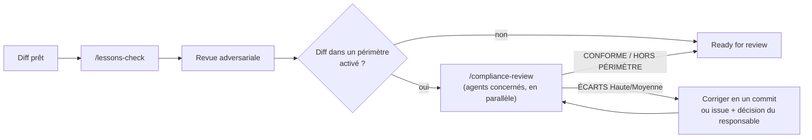

# Conformité : relecteurs spécialisés

Fondation pour ajouter des exigences de conformité à la boucle de revue sans alourdir chaque PR. Un relecteur de
conformité est un **sous-agent en lecture seule**, lancé seulement quand le diff touche son périmètre. Il produit des
**hypothèses d'écart** sourcées, jamais une certification, un audit ou un avis juridique : le DPO, le RSSI, le QSA ou
l'auditeur tranche.

## 1. Catalogue

| Agent | Référentiel | Déclencheurs typiques dans un diff | Qui confirme |
|---|---|---|---|
| `compliance-gdpr` | RGPD (UE) 2016/679 | données personnelles, consentement, conservation, transfert hors UE, logs | DPO |
| `compliance-eu-ai-act` | AI Act (UE) 2024/1689 | appel de modèle, contenu généré, scoring, biométrie | Référent IA, juriste |
| `compliance-nis2` | Directive (UE) 2022/2555 | gestion d'incident, journalisation, chaîne d'approvisionnement, chiffrement | RSSI |
| `compliance-iso27001` | ISO/IEC 27001:2022 (annexe A) | contrôle d'accès, journalisation, développement sécurisé, fournisseurs | RSSI, auditeur |
| `compliance-soc2` | AICPA TSC 2017 (points of focus 2022) | gestion des changements, accès logiques, surveillance | Auditeur SOC 2 |
| `compliance-tisax` | ENX TISAX / VDA ISA | protection des prototypes, données de constructeur, accès | Responsable TISAX |
| `compliance-pci` | PCI DSS v4.0.1, PCI PIN, PCI P2PE | PAN, CVV, page de paiement, scripts tiers, clés, HSM, terminal | QSA |
| `compliance-hds` | Hébergement de données de santé (CSP L.1111-8, référentiel HDS) | données de santé, hébergeur, sauvegardes, localisation | Responsable HDS |

Définitions : `plugins/harness/agents/compliance-*.md` (vendorisées en `.claude/agents/`). Chaque agent porte ses
déclencheurs, sa liste de vérification (exigence → source), les preuves attendues dans le dépôt et un format de
réponse fixe. Les identifiants non vérifiés sur le texte officiel sont marqués « (à vérifier) » ; les sources
indiquent leur date de consultation. **Les référentiels évoluent** (versions, actes modificatifs, transpositions) :
la revue annuelle d'un agent est une issue du cadre.

## 2. Activation dans un projet

`.harness/config.json` :
```json
{ "compliance": ["gdpr", "pci"] }
```
- Seuls les agents listés sont lancés par `/compliance-review` ; exclure les autres de la vendorisation si on veut un
  dépôt léger (`"exclude": [".claude/agents/compliance-tisax.md"]`).
- Un label `conformité: <id>` sur une issue force la revue correspondante, même si le diff semble hors périmètre.
  Ces labels sont propres au projet : les déclarer dans `.github/labels.local.json` (le cadre ne fournit que
  `conformité`, générique).

## 3. Place dans la boucle



- Les verdicts vont dans la PR (section « Conformité ») : agent, verdict, tête relue, constats ouverts.
- Un écart que l'équipe accepte (risque assumé) se trace dans un ADR signé par le responsable, jamais en silence.
- Une faille de sécurité ne se détaille jamais publiquement.

## 4. Ajouter un référentiel
1. Issue sur le cadre (type `feature`, label `conformité`), avec les sources officielles.
2. Copier un agent existant, garder ses sections ; ne citer que des identifiants vérifiés sur le texte officiel.
3. Ajouter la ligne au §1 et l'identifiant aux valeurs reconnues par `/compliance-review` ; MINEUR au CHANGELOG.
