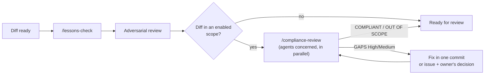

# Compliance: specialised reviewers

Foundation for adding compliance requirements to the review loop without weighing down every PR. A compliance
reviewer is a **read-only subagent**, started only when the diff touches its scope. It produces sourced
**gap hypotheses**, never a certification, an audit or legal advice: the DPO, the CISO, the QSA or
the auditor decides.

## 1. Catalogue

| Agent | Compliance framework | Typical triggers in a diff | Who confirms |
|---|---|---|---|
| `compliance-gdpr` | GDPR (EU) 2016/679 | personal data, consent, retention, transfer outside the EU, logs | DPO |
| `compliance-eu-ai-act` | AI Act (EU) 2024/1689 | model call, generated content, scoring, biometrics | AI lead, legal counsel |
| `compliance-nis2` | Directive (EU) 2022/2555 | incident handling, logging, supply chain, encryption | CISO |
| `compliance-iso27001` | ISO/IEC 27001:2022 (Annex A) | access control, logging, secure development, suppliers | CISO, auditor |
| `compliance-soc2` | AICPA TSC 2017 (points of focus 2022) | change management, logical access, monitoring | SOC 2 auditor |
| `compliance-tisax` | ENX TISAX / VDA ISA | prototype protection, manufacturer data, access | TISAX officer |
| `compliance-pci` | PCI DSS v4.0.1, PCI PIN, PCI P2PE | PAN, CVV, payment page, third-party scripts, keys, HSM, terminal | QSA |
| `compliance-hds` | Hébergement de données de santé (French health data hosting; CSP L.1111-8, HDS framework) | health data, hosting provider, backups, location | HDS officer |

Built-in agents: `plugins/harness/agents/compliance-*.md` (vendored into `.claude/agents/`), plus the generic
reviewer `compliance-reviewer` for the project's specs (§2). Each agent carries its
triggers, its checklist (requirement → source), the evidence expected in the repository and a fixed response
format. Identifiers not verified against the official text are marked "(to verify)"; sources
state the date they were consulted. **Frameworks change** (versions, amending acts, transpositions):
the yearly review of an agent is an issue on the harness.

## 2. Plugging in a framework: three modes

The harness provides agents, it does not impose them. Each company chooses, framework by framework:

| Mode | When | Declaration in `.harness/config.json` → `compliance` | What runs |
|---|---|---|---|
| **Built-in** | The framework is in the catalogue (§1) and the harness agent fits | `"gdpr"` | The harness's `compliance-gdpr` |
| **Company agent** | The company already has its reviewer (internal prompts, in-house controls, QSA tooling) | `{"id": "pci", "agent": ".claude/agents/acme-pci.md"}` | Its agent, in place of the built-in one |
| **Spec only** | The company just wants to describe its requirements (framework not in the catalogue, or internal policy) | `{"id": "dora", "spec": "docs/compliance/dora.md"}` | The generic reviewer `compliance-reviewer`, which applies the spec and nothing else |

Options common to every entry:
- `"paths"` (globs: `*` and `?` stay within one directory, `**/` covers zero or more directories, `src/**` everything
  below) and `"keywords"` (whole words, case-insensitive, searched in the added or removed lines of the diff, file
  headers excluded): the scope is decided **without starting an agent** (no token spent on an out-of-scope diff); without them, the agent judges;
- `"confirmed_by"`: who decides (DPO, CISO, QSA); `"enabled": false`: disables without deleting.

Full example:
```json
{
  "compliance": [
    "gdpr",
    { "id": "pci", "agent": ".claude/agents/acme-pci-qsa.md", "paths": ["src/paiement/**"], "confirmed_by": "QSA ACME" },
    { "id": "dora", "spec": "docs/compliance/dora.md", "keywords": ["incident", "ict"], "confirmed_by": "CISO" },
    { "id": "iso27001", "enabled": false }
  ],
  "exclude": [".claude/agents/compliance-tisax.md", ".claude/agents/compliance-hds.md"]
}
```

- Deterministic **resolution**: `.harness/scripts/compliance-plan.py --base origin/<integration>` (called by
  `/compliance-review`) says, for each entry, which agent runs, on which file, and whether the diff is in its
  scope; an invalid entry (agent not found, incomplete spec, unknown id, duplicate) makes the plan fail.
- **Spec**: template `docs/compliance/TEMPLATE.md` (created at adoption, owned by the project): header `id`,
  `framework`, `confirmed_by`, then "When to step in", "What I check", "Expected evidence", "Sources".
  The generic reviewer cites only what the spec cites; a gap in the spec is reported, not invented.
- **Company agent**: an agent file (Claude Code adapter: header `name`, `description`, `tools`, `model`) in
  the repository; the harness never syncs it. Keep the response format of §3 so that verdicts can be
  consolidated; make it read-only.
- A `compliance: <id>` label on an issue forces the matching review, even out of scope. These labels are
  project-local (`.github/labels.local.json`, like `compliance` itself: the harness base set has no compliance label).

## 3. Place in the loop



- Verdicts go in the PR ("Compliance" section): agent, verdict, head reviewed, open findings.
- A gap the team accepts (accepted risk) is traced in an ADR signed by the owner, never silently.
- A security flaw is never detailed publicly.

## 4. Adding a framework
1. Issue on the harness (`type: feature`), with the official sources.
2. Copy an existing agent, keep its sections; cite only identifiers verified against the official text.
3. Add the row to §1; MINOR in the CHANGELOG. A framework specific to one company does not come to the harness: it
   stays a spec or an agent of the project (§2).
