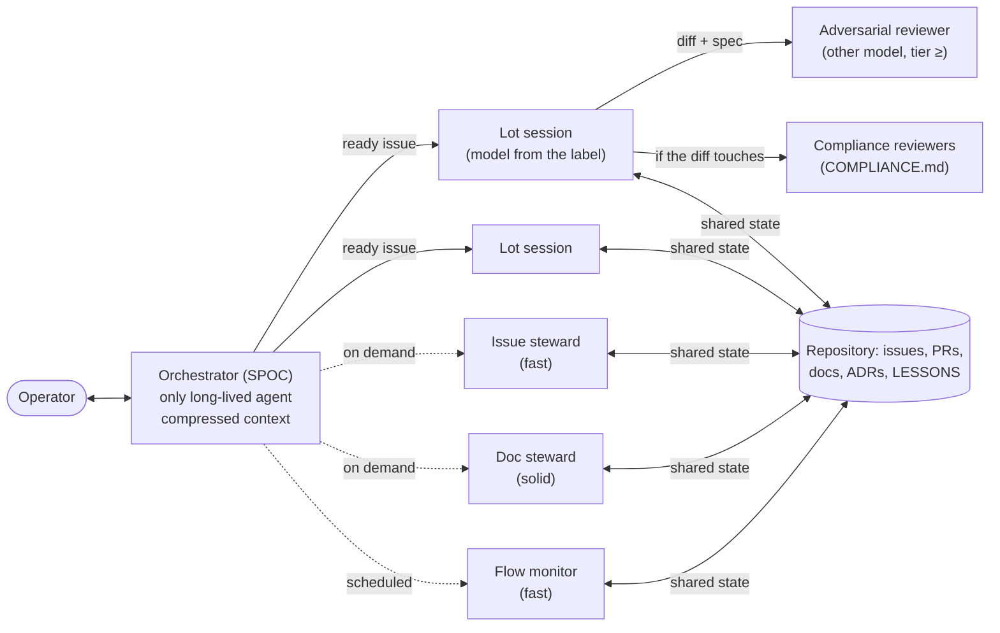

# Agentic FinOps: orchestrator, model routing, quotas, drift

How to spend tokens and CI minutes where they produce value. Complements
[ORCHESTRATION](ORCHESTRATION.md) (who does what) and [CI-BUDGET](CI-BUDGET.md) (CI minutes). Dashboard:
`flow-metrics.py` / `flow-report.yml` (§4).

## 1. Topology: one long-lived agent, disposable agents



- **The orchestrator is the operator's single point of contact (SPOC)** and the **only** long-lived agent.
  It does not code: it routes, tracks, restarts, reports. Its context is **compressed** (summaries, links to state) and
  it runs on a solid model, not necessarily the most expensive: routing takes judgement, not generation.
- **Context lives in the repository, not in the agent.** What an agent must know to resume (plan, decisions,
  progress, blockers) is in an issue, a PR, an ADR, `LESSONS.md` or a lot spec. An agent you kill therefore
  loses nothing; an agent you start reads the state and carries on. Corollary: any knowledge gained in a session that
  is worth more than the session is written down **before** the session ends (otherwise it is lost and paid for again).
- **Stewards and reviewers are disposable**: started for one task, killed after, restarted when needed
  ([STEWARDS](STEWARDS.md)). A fresh context costs less than a long one that drags its old turns along and drifts.
- **Avoid cold context**: a restarted agent does not reread the whole repository. Its prompt gives it exactly the
  useful files and issues (the brief, ORCHESTRATION §4); docs stay short and structured so they read fast
  (ESSENTIALS.md first, detail on demand).

## 2. Model routing: neither over- nor under-assignment

| Work | Tier | Why |
|---|---|---|
| Issue triage, labels, docs hygiene, status report, conventions check | fast (Haiku) | Explicit rules, verifiable output |
| Well-specified lot, several files, CI, tests | solid (Sonnet) | The bulk of the volume: the best quality / cost ratio |
| Engine, security, regulatory, architecture, flows that write | frontier (Opus) | A mistake costs more than a token |
| **Review** of a solid or frontier lot | tier ≥ author, **other model** | Reviewing costs far less than coding: putting the best model there is the best-paying investment |
| Structural decision, hard ADR | Fable / frontier + review | Rare, high leverage |

Rules:
1. **The value of the `difficulty:` label is authoritative** (ORCHESTRATION §2). Under-assigning (Haiku on a financial
   rule) costs review rounds and bugs; over-assigning (Opus on a rename) costs tokens with no measurable gain.
2. **Delegate early**: as soon as a task can be split (including initial planning, research, reading a
   large file), a subagent of the right tier takes it; the main agent keeps the conclusion, not the files read.
   Do not delegate what fits in a few tool calls (the brief would cost more than the work).
3. **A stronger model reviews, a fitting model writes.** Measure: if a fast tier needs more than two review
   rounds on a type of task, raise the label for that type; if a frontier tier never finds anything to fix
   in a solid author's work, the review can go down one notch for that type.
   **This moves with the models.** The working hypothesis, which §5 lets each project check, is that as models
   improve the adversarial review finds fewer real defects and a lower tier can take it over. Lowering the reviewer
   tier is the operator's decision, never an automatic rule, and it reads two signals together over the same period:
   few `[fixed]` findings **and** few defects `Introduced by` a PR the review approved (few findings alone is also
   what a weak reviewer produces). The floor stays: another model, a tier at least that of the author, the highest
   tier for security, authentication and flows that write (ORCHESTRATION §2). Raise it back when escaped defects
   come back.

## 3. Quotas, parallelism and resuming

- **Parallelism is bounded by the system, not by the calendar**: concurrent CI runners, open PRs per
  contributor, allowed sessions, shared files (serialise what touches the same files), the operator's review
  capacity. Within these bounds, start everything that is ready.
- **No holding back out of quota bias**: delaying a delivery to "use up the quota" on the last day before the
  reset, or spreading work out to "keep some quota", is a human bias, not efficiency. The quota is
  a scheduling constraint: deliver as soon as it is ready, prioritise (security, `priority: high`, critical path)
  when it runs low.
- **Quota reached (tokens or minutes)**: the orchestrator writes the state on every issue in progress ("Handoff: …"),
  schedules its resumption at the reset time (e.g. Claude Code: `send_later`; or a scheduled task, never a wait loop)
  and stops cleanly. On resuming: reread the repository state (L18, L19), not its memory.
- **CI minutes exhausted**: local checks before every merge (`local-check.sh`, which says "INCOMPLETE" when a tool is
  missing), CI-BUDGET §2.
- **Bounded loops** (after the repair loop of OpenHarness, [`autopilot/service.py`](https://github.com/HKUDS/OpenHarness/blob/main/src/openharness/autopilot/service.py), `repair max_rounds`, read on 2026-11-07):
  at most **3 review rounds** and **6 CI-tested pushes** per PR; beyond that, the orchestrator stops the author, writes
  the diagnosis on the issue and reassigns (model above, spec to clarify, or a human).

## 4. Watching for drift

The dashboard (`flow-report.yml`, script `flow-metrics.py`) computes every day, from the GitHub API:

| Signal | Default threshold | Reading | Action |
|---|---|---|---|
| Claimed issue (`/claim`, label `status: claimed`) with no activity | 24 h | Session dead or silently blocked | Watchdog: stop, note the state, release the issue |
| Ready PR with no activity / draft | 24 h / 120 h | Review or author stalled | Nudge the right actor |
| CI-tested pushes on a PR (distinct SHAs, skipped or cancelled runs excluded) | > 6 | Trial-push loop | Stop, local diagnosis, one commit per round |
| Reviews on a PR | > 3 | Review loop (fixes to the instance, not the class) | Cross-check, REVIEW-ROUNDS §3 |
| `status: blocked`, `status: needs-decision` | any | External bottleneck or product decision | Escalate to the operator, with the exact question |
| Median time from open to merge | trend | Flow | Compare week over week |
| Merged PRs, agents / humans | trend | Agentic volume | Calibrate CI and review (CI-BUDGET §5) |
| Billed minutes, CI failure rate | trend | Overconsumption | A rise without a rise in volume = drift |
| **Problem PRs** (≥ 1 review finding: adversarial, AI, compliance, CodeRabbit, human), agents / humans | > 50 % from 3 PRs | Insufficient initial quality | Tighten `/lessons-check`, the spec (intent), or raise the `difficulty:` label |
| Fix effort: commits after the 1st finding, time from 1st finding to merge | trend | Cost of the second pass | Compare by source and by model tier |
| Merged PRs with no traced verdict | any | Blind measurement | Apply REVIEW-ROUNDS §Traceability |
| **Passed only on re-run**: a job (by name) red then green on the same commit (`run_attempt` > 1, or another run of the same workflow, event and `head_sha`); cancelled or skipped is not red, a re-run after a cancel is not a flake | any (🟠) | Flaky test or job, hidden by re-runs | One `type: bug` issue per job name; never re-run until green ([REVIEW-ROUNDS](REVIEW-ROUNDS.md), CI playbook) |
| **Red rate on the integration branch**: per job name, red / (red + green) executions of the push runs | > 20 % (🟠) | The base is red: every PR on that job inherits it | Fix the base first; no re-run of red PRs on the same job meanwhile (CI playbook) |
| **Long job**: a job `in_progress` for longer than the threshold (its `timeout-minutes` is not in the API) | 60 min (🟠; 🔴 on the integration branch) | Hung step, missing `timeout-minutes` | Cancel by hand, then fix the step or the timeout ([CI-BASELINE](CI-BASELINE.md) §2) |
| **Run queued with no job**: status `queued` and zero jobs for longer than the threshold (`pending` waits for its concurrency group and is left out) | 30 min (🟠) | GitHub-side stuck run | CI playbook: a real new event, report the run ids to GitHub Support |

Overall status: 🔴 a loop, a stalled `priority: high` issue, or a job stuck beyond its threshold on the integration
branch (it blocks every PR behind it); 🟠 a stall, a bottleneck, too many problem PRs, or any other CI health signal;
🟢 otherwise.

**CI health** reads the Actions REST API only (workflow runs, `GET /actions/runs/{id}/jobs?filter=all`, workflows):
no project artifact. Thresholds in `.harness/config.json` › `ci_health`, whole numbers, every key optional:
`long_job_minutes` (60), `queued_no_job_minutes` (30), `red_rate_percent` (20), `max_job_requests` (50); the
integration branch is `integration_branch`, else the default branch. An unknown key or a bad value is reported, not
replaced by a default. The extra requests per report are bounded: at most 3 + `max_job_requests` (workflows, runs
count, default branch, one job list per candidate run, stuck runs first, then re-runs, then the newest integration
pushes); a candidate beyond the budget is counted as "could not check". No token, no network, an API error, a run list
cut short (a filtered list stops at 1,000 runs) or an unreadable config: the signal says "could not check", never
"nothing". Runs of a deleted workflow or without `head_sha` are counted in a "not classified" line. The dashboard
never cancels, re-runs or deletes anything, and it does not open issues: it names the job and the action. (Opening the
`type: bug` issue itself would be an opt-in input of `flow-report.yml`, one open issue per job name found by a marker
`<!-- flaky: <workflow> / <job> -->` in its body; not built, the list is the default.)
Per-test durations (`.xcresult`, JUnit) belong to the project: its own CI step can parse them and fail, or post them
to the job summary; the dashboard does not read artifacts.
The problem-PR ratio also feeds routing (§2 rule 3): a model tier whose PRs often come back with
findings is under-assigned for that type of task. What the script does not
see (tokens consumed per session) is read by hand in the provider's console and carried into the
orchestrator's weekly report.

## 5. What reviews are worth: the data, not a metric

Does the adversarial review prevent real defects, or does it cost tokens and rounds for little? The harness does not
compute an answer: it keeps the data readable, and the operator draws the conclusion for their own project.

The data, written as part of the normal flow:
- **Outcome of each finding**: the settled findings listed in the PR start with `[fixed]`,
  `[declined: false positive]` or `[declined: not worth it]` ([REVIEW-ROUNDS](REVIEW-ROUNDS.md), convergence).
- **Defects that got through**: a `type: bug` or `type: security` issue found after a merge carries the line
  `Introduced by #NNN` (the PR that brought it, when known; [METHODOLOGY](METHODOLOGY.md) §6).
- **Context**: the verdict line names the reviewer's model, the PR's model line names the author's
  ([REVIEW-ROUNDS](REVIEW-ROUNDS.md), traceability).

Reading it (GitHub CLI; replace `OWNER/REPO`, `N` and the model name). Search only shortlists: it drops brackets and
colons, so `[fixed]` cannot be searched on its own, and `gh search` re-quotes phrases. Use the search API directly,
then read the tags in each PR:

```bash
q() { gh api -X GET search/issues -f q="repo:OWNER/REPO $1" --paginate --jq '.items[] | "#\(.number) \(.title)"'; }
q 'is:pr is:merged "declined false positive"'      # shortlist: PRs with a finding declined as a false positive
q 'is:pr is:merged "declined not worth it"'        # shortlist: PRs with a finding declined as not worth it
q 'is:issue "Introduced by"'                       # defects that got through (then check the type: label)
q 'is:pr is:merged "Adversarial review (fable)"'   # PRs reviewed by a model: write the name the verdicts use
# The settled findings of one PR (body and comments): a tag counts only at the start of a line
{ gh api repos/OWNER/REPO/pulls/N --jq .body; gh api repos/OWNER/REPO/issues/N/comments --paginate --jq '.[].body'; } |
  grep -oE '^[[:space:]]*([-*] )?\[(fixed|declined: false positive|declined: not worth it)\]' |
  sed 's/^[-* ]*//' | sort | uniq -c
```

Compare periods (before and after a model change) rather than reading one number. The trend feeds §2 rule 3.
