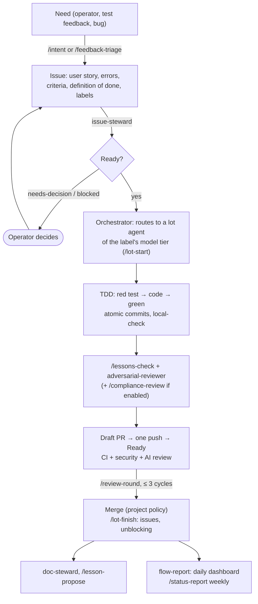

# Using the harness on a project: step-by-step guide (SwiftHFR example)

TL;DR: you **adopt** once (vendoring, [ADOPTION](ADOPTION.md)), you **configure** `.harness/config.json`, then
every need follows the same path: intent → ready issue → lot in TDD → reviews → PR → dashboard. The operator only
talks to the orchestrator.

## 1. Overview



## 2. Setup (once)

| Step | Command / file | Result |
|---|---|---|
| 1. Adopt | `harness-sync.sh --target .` ([ADOPTION](ADOPTION.md)) | `.harness/`, `.claude/skills/`, `.claude/agents/`, `CLAUDE.md` block |
| 2. Configure | `.harness/config.json`: branches, language, exclusions, `compliance` (harness agent, company agent or spec) | Rules and reviewers fitted to the project; every building block is replaceable ([ADOPTION](ADOPTION.md) §Replace) |
| 3. Labels | `.github/labels.local.json` + `labels` job of `harness.yml` | Shared taxonomy + project labels |
| 4. CI | `harness.yml`: jobs `flow`, `security`, `review` to enable | Dashboard, SAST/SCA/secrets, AI review |
| 5. Secrets | `ANTHROPIC_API_KEY` (AI review), `REPO_ADMIN_TOKEN` (repository settings), as GitHub secrets; nothing hard-coded ([CI-BUDGET](CI-BUDGET.md) §3) | — |
| 6. Milestones | GitHub milestones ("Milestone 1: …", due date) | Progress readable in the dashboard |

## 3. Day to day

| I want… | I tell the orchestrator | What happens |
|---|---|---|
| A new feature | "/intent the thread reloads by itself every 2 min" | Issue written, shown, created after agreement |
| To process test feedback | "/feedback-triage" + the notes | Umbrella + one issue per point, grouped into lots |
| To move the project forward | "take the ready issues" | Lots started in parallel within the system's limits ([FINOPS](FINOPS.md) §3), named agents (`<project>.<orc>.lot.<target>`) |
| To know where we stand | "/status-report" | Non-technical report: RAG TL;DR, milestones, blockers, decisions needed |
| A PR has bot feedback | "/review-round #231" | One full cycle, one push, one reply per thread |
| To learn from a mistake | "/lesson-propose <finding>" | Project lesson, or a "Lesson" issue on the harness |
| To move to the next harness version | "/harness-update" | Draft sync PR |

Quota reached along the way: the orchestrator writes the state on the issues, schedules its resumption at the reset
and restarts from the state of the repository ([FINOPS](FINOPS.md) §3).

## 4. Example: SwiftHFR (`ezzz/HFRnow`, branch `dev-swift`)

SwiftUI iOS client for the HFR forum; docs in English; its own lessons (`docs/agents/LESSONS.md`), lots
(`docs/LOTS.md`) and labels (`type:`, `priority:`, `difficulty:`). Repository outside the `francoisgn` account: no
calls to the reusable workflows of a private harness (ADR 0001); vendoring is enough.

**Configuration** (`.harness/config.json`, created before the first sync):
```json
{
  "language": "en",
  "exclude": [".github/ISSUE_TEMPLATE/*", ".github/pull_request_template.md", "docs/lots/TEMPLATE.md",
              ".markdownlint-cli2.jsonc", ".github/workflows/harness*.yml",
              ".claude/agents/compliance-tisax.md", ".claude/agents/compliance-pci.md",
              ".claude/agents/compliance-hds.md", ".claude/agents/compliance-soc2.md"],
  "protected_branches": ["master", "dev-swift"],
  "integration_branch": "dev-swift",
  "branch_model": "B",
  "compliance": ["gdpr"]
}
```
`gdpr`: the app handles an account, session cookies and private messages (personal data); this is a proposal for
the maintainer to confirm, not a legal qualification.

**Adoption** (cloud session with `ezzz/HFRnow` and `francoisgn/belayline-agentic-harness` attached, or Mac):
```bash
git fetch origin && git switch -c claude/adoption-harness origin/dev-swift
git clone --depth 1 --branch v0.2.0 https://github.com/francoisgn/belayline-agentic-harness.git ../belayline
../belayline/scripts/harness-sync.sh --target . --dry-run && ../belayline/scripts/harness-sync.sh --target .
```

**One lot end to end** (issue #312, `LOT-082`, label `difficulty: easy`):
1. The orchestrator `hfrnow.orc-0711.orc.dev-swift` reads the dashboard, sees #312 ready, starts the child session
   `[hfrnow] lot LOT-082 #312 · sonnet ← orc-0711` (tags `project:hfrnow`, `orc:orc-0711`, `issue:312`).
2. The child (`hfrnow.orc-0711.lot.LOT-082`) runs `/lot-start 312 LOT-082`: claim comment with its `Agent:` line,
   branch `claude/lot-082` from `dev-swift`.
3. TDD in `HFRKit` (engine, testable on Linux): red Swift Testing tests, then code, then green
   (`swift test --filter`, checking that tests did run: L01). The SwiftUI UI is reviewed with a compiler's rigour
   (L58); the Xcode build is done on a Mac ([MAC-HANDOFF](MAC-HANDOFF.md)).
4. `/lessons-check` (lessons of the harness **and** of HFRnow), then the `adversarial-reviewer` subagent on Opus
   (`hfrnow.orc-0711.rev.pr340`), then `/compliance-review`: the diff touches cookie storage → `compliance-gdpr`
   (`hfrnow.orc-0711.conf-gdpr.pr340`).
5. Draft PR, one push, "Ready": HFRnow's macOS CI, CodeRabbit (already installed on HFRnow); `/review-round`
   for its findings, at most 3 cycles.
6. Merge according to HFRnow's policy; `/lot-finish` unblocks the dependent lots; a generic lesson born here
   → `/lesson-propose` ("Lesson" issue on the harness).

## 5. New project (no history)
1. Create the repository, `main` + `develop` (model A) or a single branch (model B); adopt the harness (§2).
2. First lot: `docs/LOTS.md` (plan) and the project's ADR 0001 (architecture), produced by a frontier-tier `plan`
   agent and reviewed by another model.
3. Enable `security` from the first commit of code: a secret or a vulnerable dependency costs less early.
